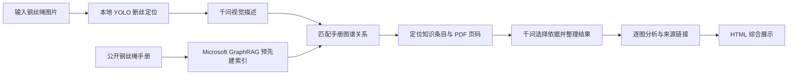

# 钢丝绳缺陷检测与 GraphRAG 运维分析 Demo

基于 YOLO、千问视觉模型和钢丝绳电子手册知识图谱，串联图片输入、断丝定位、图像描述、图谱检索、带来源的分析报告与 HTML 展示。本项目是流程演示工程，不将演示样例表现作为独立测试集准确率。

## 获取完整工程包

GitHub 代码仓库用于查阅程序、配置与说明。**实际运行请到 [Releases 下载页](https://github.com/DDRniubi/wire-rope-graphrag-demo/releases) 下载 `wire_rope_full_demo_20261016.zip` 并解压**，不要用 GitHub 自动生成的 `Source code.zip` 代替。

完整工程包额外包含两套 YOLO 权重、手册 PDF、GraphRAG 索引、三张样例图片和已生成的在线演示结果。代码仓库不重复存储这些运行资产，也不包含 Python 虚拟环境、全部训练数据或 API Key。

工程包含现场图片及其演示输出，建议仅在私有仓库中分享给获授权的项目成员。第三方组件及资料来源见 [THIRD_PARTY_NOTICES.md](THIRD_PARTY_NOTICES.md)。

## 流程概览



在线流程调用使用者自己的百炼账号；离线模式不调用千问。日常运行复用已提供的图谱索引，不需要重新建库。

首次了解整个系统，请先阅读根目录的 [完整流程说明 Word版](完整流程说明.docx)，从图片输入到YOLO、千问、GraphRAG和报告逐步了解实际实现与演示操作。另有 [GraphRAG工作内容与流程说明](docs/钢丝绳GraphRAG工作内容与流程说明.docx) 专门解释手册建库；本README侧重安装和运行。

后续多模态扩展与评价安排见 [项目流程与评价方案](docs/码头运维智能体多模态GraphRAG项目流程与评价方案.docx) 和 [审阅衔接要点](docs/方案审阅与demo衔接要点.md)。方案明确区分现有功能与待建设目标，不代表新增模块已经实现。

本包包含两个 YOLO 权重、完整电子手册、已建立的 GraphRAG 索引、图像与文本模型调用代码，以及统一运行入口。安装软件依赖需要联网；调用千问时需要使用者自己的阿里百炼 API Key。

## 一、现成结果

用浏览器打开 `runs/online_demo/complete_demo.html`。这里是本包重新运行三张样例图得到的完整结果，包含 YOLO 标框、千问视觉描述、手册图谱检索和逐图分析。查看现成页面不需要 Python 或 API Key。

页面中的“打开 GraphRAG 图谱”进入实体关系与文档问答展示；“逐图报告”和“完整检索与千问提示词”用于核对输出过程。问答展示页展示已生成的示例答案，不是自由输入问题的在线聊天服务。

## 二、安装运行环境

建议使用 Windows 10/11、64 位 Python 3.12。解压到有写入权限的目录，在本目录打开 PowerShell：

```powershell
powershell -NoProfile -ExecutionPolicy Bypass -File .\setup_env.ps1
```

脚本会创建本目录的 `.venv` 并安装依赖。若没有 `py -3.12` 命令，可指定 Python 3.12 的位置：

```powershell
powershell -NoProfile -ExecutionPolicy Bypass -File .\setup_env.ps1 -PythonExe "D:\Python312\python.exe"
```

不需要将制作者电脑上的 Python 环境复制过来。PyArrow 固定为 25.0.1，用于兼容已提供的 GraphRAG 索引。

## 三、运行完整在线流程

先在当前 PowerShell 窗口配置自己的百炼 API Key，再运行：

```powershell
$env:DASHSCOPE_API_KEY = '在这里填写自己的API Key'
powershell -NoProfile -ExecutionPolicy Bypass -File .\run_full_pipeline.ps1 -Device cpu -UseQwen
```

默认使用 `data/sample_images` 中的三张样例图。`-UseQwen` 会把 YOLO 标框图发送给千问视觉模型，并把检测描述、检索关系及手册摘录发送给千问文本模型，产生 API 费用。未配置 Key 或调用失败时会明确报错，不会将离线结果冒充在线结果。请勿把 Key 写进代码或发送给他人。

有 NVIDIA 显卡且 PyTorch 已配置 CUDA 时，可将 `-Device cpu` 改成 `-Device 0`。使用现有环境时，可增加 `-PythonExe python`，但该环境须安装 `requirements.txt` 中的依赖。

完成后打开终端显示的 `runs/run_时间/complete_demo.html`。每次运行创建新目录，不覆盖已有结果。

## 四、检测新图片与离线运行

把新图放到 `data/input_images`：

```powershell
powershell -NoProfile -ExecutionPolicy Bypass -File .\run_full_pipeline.ps1 -InputPath data\input_images -Device cpu -UseQwen
```

`-InputPath` 也支持单张图片或其他文件夹的绝对路径。图片会复制进本次结果目录，便于结果随目录移动。

不加 `-UseQwen` 时，运行本地 YOLO、已有图谱关系检索及报告框架，不上传图片、不调用千问；报告会明确标记没有生成千问视觉描述和文档分析。这种模式用于检查本地流程，不等同于完整在线分析。

## 五、文件分类

| 目录或文件 | 内容 |
|---|---|
| `models/site_yolo/best.pt` | 默认现场断丝模型，训练名称为 `site_broken_wire_det_v6_hnm2`。 |
| `models/dbtt_yolo/best.pt` | 公开 DBTT 预训练模型，训练名称为 `dbtt_broken_wire_pretrain2`。 |
| `detection/` | YOLO 推理、千问图片描述、检测数据与 Word 报告生成代码。 |
| `knowledge/source/` | 238 页 USACE 钢丝绳手册 PDF。 |
| `knowledge/input/` | 199 页有效文本，保留 PDF 页码。 |
| `knowledge/output/` | 实际 GraphRAG 索引表及 LanceDB 向量数据。 |
| `knowledge/prompts/`、`settings.yaml` | 建图提示词与模型配置；Key 通过环境变量读取。 |
| `knowledge/demo_artifacts/` | 图谱可视化及已生成的手册问答。 |
| `knowledge/*.py` | 图谱检索、手册分析、建索引、结果检查等程序。 |
| `scripts/run_pipeline.py` | 完整流程的实际调度代码。 |
| `data/` | 样例图和新图片输入目录。 |
| `runs/online_demo/` | 使用本包重新执行的在线流程结果。 |
| `evaluation/` | DBTT 断丝定位评估脚本，使用时另行提供带标签的数据集。 |
| `docs/` | 模型分工、流程与验证记录。 |
| `manifest.json` | 打包文件 SHA-256 清单。 |

## 六、切换公开集 YOLO

```powershell
powershell -NoProfile -ExecutionPolicy Bypass -File .\run_full_pipeline.ps1 -ModelSet dbtt -InputPath "D:\DBTT\test\images" -ImageSize 800 -Device cpu -UseQwen
```

DBTT 权重包含 `break`、`thunderbolt`、`wear` 三类。本包完整流程仅取类别 0，即断丝 `break`；不会把其他类别当断丝写进报告。默认现场模型也仅检测类别 0。

本包没有附带全部 DBTT 训练与测试数据，也没有因更换权重而声明达到 90% 准确率。单独评估定位 precision/recall 时，可运行：

```powershell
.\.venv\Scripts\python.exe .\evaluation\demo_dbtt_yolo_precision.py --dataset "D:\DBTT-yolo" --device cpu
```

该脚本要求数据集包含 `train`、`valid`、`test` 的 images 与 labels；详情见脚本 `--help`。

建议同时报告定位 Precision、Recall 和 mAP50，而不是只给出笼统的“准确率”。提高置信度阈值可能提高 Precision，也可能增加漏检；阈值应在验证集选择，再在隔离的测试集评价。上述单独评估脚本提供 IoU=0.5 下的 Precision、Recall 和 F1，不包含完整 mAP 曲线计算。

## 七、GraphRAG 与千问的实际分工

Microsoft GraphRAG 已将手册建成实体、关系、社区和向量索引。新图运行时不重新建库：程序依据图像描述匹配索引中的关系，定位 PDF 页，再调用 `qwen-plus` 整理图像结果并选择经原文核对的知识条目。逐图报告目前限定在已核对的通用检查页面；这不是 Microsoft GraphRAG 默认的 local/global search 接口。具体检索规则、候选页、选择结果与提示词均保存在各图的 `document_graphrag/traces` 中。

`qwen3.5-omni-flash` 负责看标框图，`qwen-plus` 负责文档分析，`text-embedding-v4` 用于建库向量。它们通过百炼 API 使用，包内没有这些云端模型的权重。YOLO 权重和已生成的 GraphRAG 索引均在本地。

手册为 USACE 民用工程设施钢丝绳资料。报告引用的是检查与维护知识，不能把这份手册直接当成港口岸桥适用的判废标准。

### 知识来源与索引规模

知识来源为美国陆军工程兵团发布的 [Wire Rope for Civil Works Structures, EM 1110-2-3200](https://www.publications.usace.army.mil/Portals/76/Publications/EngineerManuals/EM_1110-2-3200.pdf)。PDF 共 238 页，其中 199 页有效提取文本进入建库，实际索引包含 321 个文本块、1,796 个实体、2,741 条关系、349 个社区及对应社区报告。页码使用 PDF 页序，不保证等于手册印刷页码。

当前逐图检索属于自定义图谱关系检索：匹配实体名称与关系描述，选择相关关系，再关联到文档页；**不是在逐图阶段执行默认 local/global search，也没有调用向量相似度检索**。分析依据限制在已核对的通用检查条目，原始提示词、关系 ID 与页码保存在输出的 traces 文件中。

尚未实现自由输入问题的聊天界面、手册插图理解、表格单元格解析、跨多份手册检索及自动判废决策。完整流程演示不代表上述扩展已完成。

## 八、需要重新建图时

日常检测无需执行本节。更换知识来源或重新建库才需要安装索引依赖并调用 API：

```powershell
powershell -NoProfile -ExecutionPolicy Bypass -File .\setup_env.ps1 -WithGraphIndexing
$env:DASHSCOPE_API_KEY = '自己的API Key'
.\.index-venv\Scripts\python.exe .\knowledge\run_index.py --root .\knowledge --skip-validation
.\.index-venv\Scripts\python.exe .\knowledge\run_questions.py
.\.index-venv\Scripts\python.exe .\knowledge\export_demo.py
```

重新建库使用独立的 `.index-venv`，因为 GraphRAG 建库依赖的 NumPy/Pandas 版本与当前 YOLO 环境不同。上述操作可能产生较多 API 费用，并更新 `knowledge/output`。先保留原索引副本。当前提供的 PDF、输入文本、索引和展示数据已齐全，可直接用于演示。

## 九、重点输出与检查

| 输出 | 查看内容 |
|---|---|
| `complete_demo.html` | 完整流程展示入口。 |
| `pipeline_summary.json` | 是否完成、使用哪个模型、检测参数、是否启用千问。 |
| `image_events.json` | 每张图的检测框及事件信息。 |
| `document_graphrag/reports/` | 逐图分析及 PDF 来源页码。 |
| `document_graphrag/traces/` | 图谱关系、原文依据、提示词与模型响应。 |
| `document_graphrag/graph_demo/demo_artifacts/index.html` | 手册知识图谱及预生成问答展示。 |

可在不调用 API 的情况下检查已有完整结果：

```powershell
.\.venv\Scripts\python.exe .\knowledge\verify_complete_demo.py --run .\runs\online_demo
```

提供的三张图片在线结果已检查图谱关系 ID、来源引用、PDF 哈希及本地页面链接。曾对搬移后的工程包做过运行检查；尚未在一台全新电脑上完成依赖安装和 GPU 兼容性验证。

## 十、发布与保密

- `scripts/build_archive.py` 生成完整工程 ZIP 及 SHA-256 文件清单，排除虚拟环境、缓存与非演示运行记录。
- `scripts/export_github.py` 从完整包导出轻量代码仓库，不复制模型、样例图片、索引、PDF 或运行结果。
- 运行数据和模型只放在完整包中；完整包应作为私有仓库 Release 附件分发。
- 百炼 Key 仅通过环境变量提供。不要提交 `.env`、令牌、私人数据集或新生成的运行结果。
- 本仓库没有为第三方资料、模型或代码统一授予开源许可；公开发布前须确认相关权利及项目保密要求。
